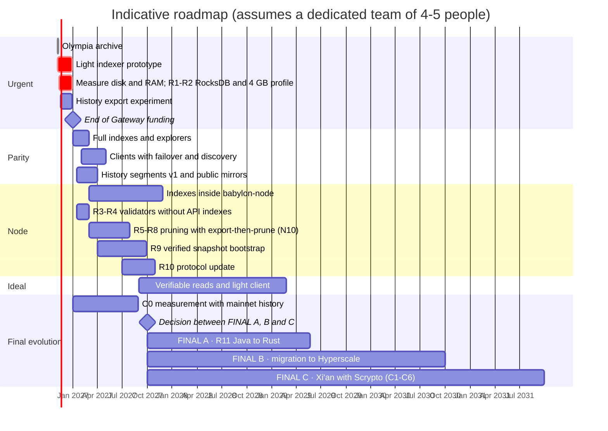

[← Index](../../README.md) · [Previous: Chapter 7: concrete changes in each repository](07-per-repository-changes.md) · [Next: Chapter 9: lighter nodes (RAM and disk) and the Java to Rust migration](09-lighter-nodes.md)

# 8. Roadmap

> [!IMPORTANT]
> - **Is it possible?** Only partly before 31 Dec 2026: the critical subset of the light indexer can have a prototype if work starts now; the rest of the plan arrives in 2027 and later years.
> - **Difficulty:** Medium for the short-term schedule; very high for phases F4-F5.
> - **Effort and timeline:** dates assume a dedicated team of about 4-5 full-time people (an assumption of this report); with fewer people, timelines lengthen.

| Phase | Indicative dates | Content | Result |
|---|---|---|---|
| **F0** | Nov-Dec 2026 | **Verifiable archive of the Olympia ledger** ([2.2](01-02-current-situation.md#s2-2)), before it is switched off. **Confirm and publish the per-column-family size of a mainnet node** (there is already a first measurement contributed by Daffy, a community member: ~493 GB). R1-R2 (RocksDB and 4 GB profile). `radix-lite-indexer` prototype with the critical subset: status, submit, preview, balances, NFTs, metadata, subintents, validators. `babylon-nodecli` profile. Conformance tests against the public Gateway. History export experiment ([10.8](10-implementation-guide.md#s10-8)). | Today's wallets, RDT and ROLA work by changing only the URL |
| **F1** | Jan-Feb 2027 | History, NFT-location and role-rule indexes. Explorer indexes (holders, statistics, search). Resubmission. Public mode. Snapshots. R3-R4 (validators without API indexes; receipts without previous values). Indexer cache and load test of a public read node ([6.4](06-recommended-solution.md#s6-4)). Validator `api_endpoints` convention. First release of `radix-explorer`. History segment format v1 and first public mirrors ([6.5](06-recommended-solution.md#s6-5)). | Parity with what clients use. Explorers without the Gateway. Several node operators serving data with the indexer. |
| **F2** | Feb-Apr 2027 | Clients: lists with failover and discovery (Sargon, wallets, RDT, ROLA, extension, SDK). Resubmission in Sargon. Fixes (`BaseUrlInterceptor`, hard-coded mainnet, hard-coded services). | No central default provider |
| **F3** | 2027 | Stage C0 of chapter [13](13-xian-with-scrypto.md#s13) (measurement with mainnet history), before the decision on the final evolution. `babylon-node`: N1, N6, N7, N5b, then N2-N4. R5-R8 (disk reduction and pruned node, with the export-then-prune rule and N10) and R9 (verified snapshot bootstrap). Snapshot capture in consultation. | Every node is an access point; the indexer becomes optional |
| **F4** | 2027-2029 | Phased migration of the core to Rust (R11), **if governance chooses FINAL A** (section [11.8](11-hyperscale-evolution.md#s11-8)); with FINAL C, R11 is replaced by stage C4, within F5. Protocol update R10. Verifiable reads and light client ([6.2](06-recommended-solution.md#s6-2), [10.6](10-implementation-guide.md#s10-6)). | 4 GB nodes with headroom; access without trusting the node |
| **F5** | After the governance decision | Migration to Hyperscale (chapter [11](11-hyperscale-evolution.md#s11)) **or** evolution of Babylon into Xi'an with Scrypto (chapter [13](13-xian-with-scrypto.md#s13), stages C1-C6). For Hyperscale: mainnet readiness, read API and indexer, wallets, genesis with verifiable claims, dApp rewrites. | Final evolution of Radix, if the community adopts it |

## 8.1 The phases step by step

Each phase gives its goal, the steps in order, what is delivered and how to know it is finished. Phases F0-F3 do not depend on the decision about the final evolution; F4 and F5 do.

**How each goal advances across the phases:**

| Goal | F0 | F1 | F2 | F3 | F4 | F5 |
|---|---|---|---|---|---|---|
| 1. Remove the Gateway | Prototype of the critical subset | Parity with what clients use | Clients with no central URL | Reads inside the node (E2) | — | API of the final network |
| 2. Network access that depends on no one | History experiment | Several operators; replicated segments | On-ledger discovery and failover | Every node is an access point; export, then prune | Verifiable reads | — |
| 3. Lighter nodes | Measure; R1-R2 | R3-R4 | — | R5-R9 | R11 (FINAL A) | C4 (FINAL C) |
| 4. Everything on Layer 1 | — | `api_endpoints` on ledger | — | — | R10; verifiable indexes | Final evolution on Layer 1 |
| 5. Preserve history | Olympia archive; history experiment | Segments v1 and public mirrors | — | N10 and export, then prune | — | Per-shard export (B and C) |
| 6. Final evolution | — | Stage C0: starts (Jan 2027) | — | C0: report (Aug 2027); decision (Sep 2027) | — | FINAL A, B or C |

### F0 · Nov-Dec 2026: save what is urgent and prove the replacement

**Goal:** that nothing is lost if the Gateway is switched off on 31 Dec 2026, and that a tested replacement exists for the essentials.

1. **Olympia archive** ([10.5](10-implementation-guide.md#s10-5)): obtain a copy, export, seal with several signatures and publish on IPFS, BitTorrent and Arweave.
   - **Status: completed on 8 Nov 2026** (copy, export, publication on Hugging Face and archive.org, explorer and verification against the Babylon genesis). Sealing with several signatures and the IPFS, BitTorrent and Arweave replicas are left out, by the maintainer's decision. Details in the [progress report](progress-f0-1-olympia-archive-and-explorer.md).
2. **Record the public Gateway:** real requests and responses for the chapter [2](01-02-current-situation.md#s2) routes, with varied addresses, for the conformance tests ([10.1](10-implementation-guide.md#s10-1)). This is only possible while it is still running.
3. **Measure:** per-column-family size (`raw_db_size`) and real RAM of a mainnet node, confirming the contributed measurement (~493 GB).
4. **R1 and R2 on Stokenet:** RocksDB memory limits and the 4 GB profile, with a long-running test.
5. **`radix-lite-indexer` prototype** with the critical subset: state, submission with resubmission, preview, balances, NFTs, metadata, subintents and validators ([10.1](10-implementation-guide.md#s10-1)).
6. **`babylon-nodecli` profile** to deploy node and indexer together.
7. **History experiment** ([10.8](10-implementation-guide.md#s10-8)): two exporters next to two nodes, checking that their segments are identical.

**Deliverables:** Olympia archive sealed and replicated; prototype published; measurements published; history experiment report.
**Success criterion:** the Android and iOS wallets, the RDT and ROLA work on Stokenet and mainnet pointed at the prototype, and the conformance tests for the critical subset pass.

### F1 · Jan-Feb 2027: parity and several operators

**Goal:** cover everything clients and explorers use, with several independent operators.

1. History, NFT-location, role-rule, locker and emission indexes (indexes a-g, section [7.1](07-per-repository-changes.md#s7-1)).
2. Explorer indexes: holders, statistics and search (h-j) and the first release of `radix-explorer`.
3. Transaction resubmission and public mode with limits ([10.1](10-implementation-guide.md#s10-1)).
4. Indexer cache and a **load test** of a public read node ([6.4](06-recommended-solution.md#s6-4)).
5. Index snapshots, so that a new operator does not have to index from genesis.
6. R3-R4 in `babylon-node`: validators without API indexes and receipts without previous values ([9.4](09-lighter-nodes.md#s9-4)).
7. The `api_endpoints` convention in validator metadata ([10.2](10-implementation-guide.md#s10-2)).
8. **Segment format v1** and the first public mirrors on at least two stores run by different operators ([6.5](06-recommended-solution.md#s6-5)).

**Deliverables:** complete indexer; reference explorer; load-test results; first public segments.
**Success criterion:** at least three independent operators serve the API format reliably, and no client needs the public Gateway any more.

### F2 · Feb-Apr 2027: clients with no default provider

**Goal:** wallets, dApps and tools find nodes by themselves and switch between them without intervention.

1. `LedgerBackend` interface in Sargon, with a bootstrap list, on-ledger discovery and failover ([10.4](10-implementation-guide.md#s10-4)).
2. Transaction resubmission in Sargon as well.
3. The same in the RDT, ROLA, the Connector Extension and the SDK.
4. Pending fixes: `BaseUrlInterceptor`, hard-coded mainnet and hard-coded services (chapter [7](07-per-repository-changes.md#s7)).

**Deliverables:** published releases of Sargon, the wallets, the RDT and ROLA.
**Success criterion:** if the node a wallet is connected to goes down, the wallet keeps working with another without the user doing anything, and no mandatory central URL remains in the code.

### F3 · 2027: the node serves reads and slims down

**Goal:** every node can be an access point, with less disk, and history stays safe even with pruning.

1. In `babylon-node`: N1, N6 and N7 (batch reads), N5b, then N2-N4.
2. R5-R7 (disk reduction) and R8 (pruned node) **with the export-then-prune rule** and N10 ([6.5](06-recommended-solution.md#s6-5)).
3. R9: bootstrapping from a verified snapshot.
4. Governance snapshot capture in consultation (E6).
5. Stage C0 of chapter [13](13-xian-with-scrypto.md#s13): measure on mainnet history how many transactions would cross shards, as input for the decision on the final evolution.

**Deliverables:** node releases with these options; history segments with receipts; C0 report.
**Success criterion:** a validator fits in 500 GB; a new node starts in hours from a verified snapshot; the full history is in at least three independent, verified replicas.

### F4 · 2027-2029: node in Rust and verifiable reads

**Goal:** comfortable headroom in 4 GB, and a wallet that does not have to trust any node.

1. R11: phased migration of the core to Rust, if governance chooses FINAL A. If it chooses FINAL C, R11 is not done: stage C4 replaces it, within F5.
2. R10: protocol update for the proposal statistics.
3. Merkle-proof endpoint and light client in Rust and WebAssembly ([6.2](06-recommended-solution.md#s6-2), [10.6](10-implementation-guide.md#s10-6)).
4. Design of the verifiable indexes, together with R10.

**Deliverables:** node in Rust; light client in Sargon and in the browser.
**Success criterion:** the wallet verifies every read against the signed roots; a node runs in 4 GB with headroom.

### F5 · after the governance decision: final evolution

**Goal:** carry out the chosen final stage.

- **FINAL A (keep improving Babylon):** complete R11 and keep tuning the node (R1-R10) as the network grows.
- **FINAL B (Hyperscale):** mainnet readiness, read API and indexer, wallets, genesis with verifiable claims and dApp rewrites (chapter [11](11-hyperscale-evolution.md#s11), strategy M1).
- **FINAL C (Xi'an with Scrypto):** stages C1-C6 of chapter [13](13-xian-with-scrypto.md#s13).

**Decision criteria:** the C0 report, Hyperscale's maturity, the team available and the network's capacity demand (section [13.11](13-xian-with-scrypto.md#s13-11)).

---

[← Index](../../README.md) · [Previous: Chapter 7: concrete changes in each repository](07-per-repository-changes.md) · [Next: Chapter 9: lighter nodes (RAM and disk) and the Java to Rust migration](09-lighter-nodes.md)
