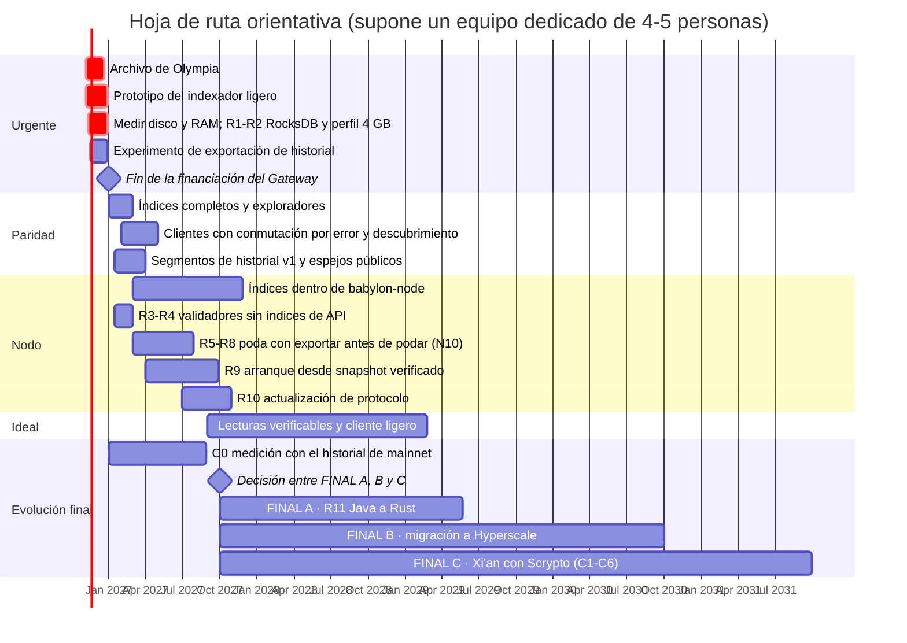

[← Índice](../../README.es.md) · [Anterior: Capítulo 7: cambios concretos en cada repositorio](07-cambios-por-repositorio.md) · [Siguiente: Capítulo 9: nodos más ligeros (RAM y disco) y migración de Java a Rust](09-nodos-ligeros.md)

# 8. Hoja de ruta

> [!IMPORTANT]
> - **¿Es posible?** Solo en parte antes del 31-dic-2026: el subconjunto crítico del indexador ligero puede tener un prototipo si se empieza ya; el resto del plan llega en 2027 y años siguientes.
> - **Dificultad:** Media para el calendario a corto plazo; muy alta para las fases F4-F5.
> - **Esfuerzo y plazo:** las fechas suponen un equipo dedicado de unas 4-5 personas a tiempo completo (supuesto de este informe); con menos personas, los plazos se alargan.

| Fase | Fechas orientativas | Contenido | Resultado |
|---|---|---|---|
| **F0** | nov.-dic. 2026 | **Archivo verificable del ledger de Olympia** ([2.2](01-02-situacion-actual.md#s2-2)), antes de que se apague. **Confirmar y publicar el tamaño por column family de un nodo de mainnet** (ya hay una primera medición aportada por Daffy, miembro de la comunidad: ~493 GB). R1-R2 (RocksDB y perfil de 4 GB). Prototipo de `radix-lite-indexer` con el subconjunto crítico: estado, envío, preview, saldos, NFT, metadatos, subintents, validadores. Perfil en `babylon-nodecli`. Pruebas de conformidad contra el Gateway público. Experimento de exportación de historial ([10.8](10-guia-de-implementacion.md#s10-8)). | Wallets, RDT y ROLA actuales funcionan cambiando solo la URL |
| **F1** | ene.-feb. 2027 | Índices de historial, ubicación de NFT y reglas de rol. Índices para exploradores (titulares, estadísticas, búsqueda). Reenvío. Modo público. Snapshots. R3-R4 (validadores sin índices de API; recibos sin valores previos). Caché del indexador y prueba de carga de un nodo de lectura público ([6.4](06-solucion-recomendada.md#s6-4)). Convención `api_endpoints` en los validadores. Primera versión de `radix-explorer`. Formato de segmento de historial v1 y primeros espejos públicos ([6.5](06-solucion-recomendada.md#s6-5)). | Paridad con lo que usan los clientes. Exploradores sin Gateway. Varios operadores de nodos sirviendo datos con el indexador. |
| **F2** | feb.-abr. 2027 | Clientes: listas con conmutación por error y descubrimiento (Sargon, wallets, RDT, ROLA, extensión, SDK). Reenvío en Sargon. Correcciones (`BaseUrlInterceptor`, mainnet fijo, servicios fijos). | Sin proveedor por defecto central |
| **F3** | 2027 | Etapa C0 del capítulo [13](13-xian-con-scrypto.md#s13) (medición con el historial de mainnet), antes de la decisión sobre la evolución final. `babylon-node`: N1, N6, N7, N5b, después N2-N4. R5-R8 (reducción de disco y nodo podado, con la regla de exportar antes de podar y N10) y R9 (arranque desde snapshot verificado). Captura de snapshots en consultation. | Cada nodo es un punto de acceso; el indexador pasa a ser opcional |
| **F4** | 2027-2029 | Migración del núcleo a Rust (R11) por fases, **si la gobernanza elige FINAL A** (sección [11.8](11-evolucion-hyperscale.md#s11-8)); con FINAL C, R11 se sustituye por la etapa C4, dentro de F5. Actualización de protocolo R10. Lecturas verificables y cliente ligero ([6.2](06-solucion-recomendada.md#s6-2), [10.6](10-guia-de-implementacion.md#s10-6)). | Nodos de 4 GB con margen; acceso sin confiar en el nodo |
| **F5** | Tras la decisión de la gobernanza | Migración a Hyperscale (capítulo [11](11-evolucion-hyperscale.md#s11)) **o** evolución de Babylon a Xi'an con Scrypto (capítulo [13](13-xian-con-scrypto.md#s13), etapas C1-C6). En el caso de Hyperscale: preparación para mainnet, API de lectura e indexador, wallets, génesis con reclamación verificable, reescritura de dApps. | Evolución final de Radix, si la comunidad la adopta |

## 8.1 Las fases paso a paso

Cada fase indica su objetivo, los pasos en orden, lo que se entrega y cómo se sabe que está terminada. Las fases F0-F3 no dependen de la decisión sobre la evolución final; F4 y F5 sí.

**Cómo avanza cada objetivo a lo largo de las fases:**

| Objetivo | F0 | F1 | F2 | F3 | F4 | F5 |
|---|---|---|---|---|---|---|
| 1. Eliminar el Gateway | Prototipo del subconjunto crítico | Paridad con lo que usan los clientes | Clientes sin URL central | Lectura dentro del nodo (E2) | — | API de la red final |
| 2. Que el acceso no dependa de nadie | Experimento de historial | Varios operadores; segmentos replicados | Descubrimiento en la cadena y conmutación | Cada nodo es un punto de acceso; exportar antes de podar | Lecturas verificables | — |
| 3. Nodos más ligeros | Medir; R1-R2 | R3-R4 | — | R5-R9 | R11 (FINAL A) | C4 (FINAL C) |
| 4. Todo en la capa 1 | — | `api_endpoints` en la cadena | — | — | R10; índices verificables | Evolución final en la capa 1 |
| 5. Conservar el historial | Archivo de Olympia; experimento de historial | Segmentos v1 y espejos públicos | — | N10 y exportar antes de podar | — | Exportación por fragmento (B y C) |
| 6. Evolución final | — | Etapa C0: empieza (ene-2027) | — | C0: informe (ago-2027); decisión (sep-2027) | — | FINAL A, B o C |

### F0 · nov.-dic. 2026: salvar lo urgente y demostrar el sustituto

**Objetivo:** que nada se pierda si el Gateway se apaga el 31-dic-2026 y que exista un sustituto probado para lo imprescindible.

1. **Archivo de Olympia** ([10.5](10-guia-de-implementacion.md#s10-5)): obtener una copia, exportar, sellar con varias firmas y publicar en IPFS, BitTorrent y Arweave.
   - **Estado: completada el 8-nov-2026** (copia, export, publicación en Hugging Face y archive.org, explorador y verificación contra la génesis de Babylon). El sellado con varias firmas y las réplicas en IPFS, BitTorrent y Arweave quedan fuera, por decisión del responsable. Detalle en el [informe de progreso](progreso-f0-1-archivo-y-explorador-olympia.md).
2. **Grabar el Gateway público:** peticiones y respuestas reales de las rutas del capítulo [2](01-02-situacion-actual.md#s2), con direcciones variadas, para las pruebas de conformidad ([10.1](10-guia-de-implementacion.md#s10-1)). Solo es posible mientras siga activo.
3. **Medir:** tamaño por column family (`raw_db_size`) y RAM real de un nodo de mainnet, confirmando la medición aportada (~493 GB).
4. **R1 y R2 en Stokenet:** límites de memoria de RocksDB y perfil de 4 GB, con prueba prolongada.
5. **Prototipo de `radix-lite-indexer`** con el subconjunto crítico: estado, envío con reenvío, simulación, saldos, NFT, metadatos, subintents y validadores ([10.1](10-guia-de-implementacion.md#s10-1)).
6. **Perfil en `babylon-nodecli`** para desplegar nodo e indexador juntos.
7. **Experimento de historial** ([10.8](10-guia-de-implementacion.md#s10-8)): dos exportadores junto a dos nodos, comprobando que sus segmentos son idénticos.

**Entregables:** archivo de Olympia sellado y replicado; prototipo publicado; mediciones publicadas; informe del experimento de historial.
**Criterio de éxito:** los wallets Android e iOS, la RDT y ROLA funcionan en Stokenet y mainnet apuntando al prototipo, y las pruebas de conformidad del subconjunto crítico pasan.

### F1 · ene.-feb. 2027: paridad y varios operadores

**Objetivo:** cubrir todo lo que usan los clientes y los exploradores, con varios operadores independientes.

1. Índices de historial, ubicación de NFT, reglas de rol, lockers y emisiones (índices a-g, sección [7.1](07-cambios-por-repositorio.md#s7-1)).
2. Índices para exploradores: titulares, estadísticas y búsqueda (h-j) y primera versión de `radix-explorer`.
3. Reenvío de transacciones y modo público con límites ([10.1](10-guia-de-implementacion.md#s10-1)).
4. Caché del indexador y **prueba de carga** de un nodo de lectura público ([6.4](06-solucion-recomendada.md#s6-4)).
5. Snapshots de índices, para que un operador nuevo no tenga que indexar desde la génesis.
6. R3-R4 en `babylon-node`: validadores sin índices de API y recibos sin valores previos ([9.4](09-nodos-ligeros.md#s9-4)).
7. Convención `api_endpoints` en los metadatos de los validadores ([10.2](10-guia-de-implementacion.md#s10-2)).
8. **Formato de segmento v1** y primeros espejos públicos en al menos dos almacenamientos de operadores distintos ([6.5](06-solucion-recomendada.md#s6-5)).

**Entregables:** indexador completo; explorador de referencia; resultados de la prueba de carga; primeros segmentos públicos.
**Criterio de éxito:** al menos tres operadores independientes sirven el formato de API de forma estable, y ningún cliente necesita ya el Gateway público.

### F2 · feb.-abr. 2027: clientes sin proveedor por defecto

**Objetivo:** que wallets, dApps y herramientas encuentren los nodos por sí mismos y cambien de uno a otro sin intervención.

1. Interfaz `LedgerBackend` en Sargon, con lista de arranque, descubrimiento en la cadena y conmutación por error ([10.4](10-guia-de-implementacion.md#s10-4)).
2. Reenvío de transacciones también en Sargon.
3. Lo mismo en la RDT, ROLA, la Connector Extension y el SDK.
4. Correcciones pendientes: `BaseUrlInterceptor`, mainnet fijo y servicios fijos (capítulo [7](07-cambios-por-repositorio.md#s7)).

**Entregables:** versiones publicadas de Sargon, wallets, RDT y ROLA.
**Criterio de éxito:** si se apaga el nodo al que está conectado un wallet, este sigue funcionando con otro sin que el usuario haga nada, y no queda ninguna URL central obligatoria en el código.

### F3 · 2027: el nodo sirve lecturas y adelgaza

**Objetivo:** que cada nodo pueda ser un punto de acceso, con menos disco, y que el historial esté a salvo aunque se pode.

1. En `babylon-node`: N1, N6 y N7 (lecturas por lotes), N5b y después N2-N4.
2. R5-R7 (reducción de disco) y R8 (nodo podado) **con la regla de exportar antes de podar** y N10 ([6.5](06-solucion-recomendada.md#s6-5)).
3. R9: arranque desde un snapshot verificado.
4. Captura de snapshots de gobernanza en consultation (E6).
5. Etapa C0 del capítulo [13](13-xian-con-scrypto.md#s13): medir con el historial de mainnet cuántas transacciones serían entre fragmentos, como dato para la decisión sobre la evolución final.

**Entregables:** versiones del nodo con estas opciones; segmentos de historial con recibos; informe de C0.
**Criterio de éxito:** un validador cabe en 500 GB; un nodo nuevo arranca en horas desde un snapshot verificado; el historial completo está en al menos tres réplicas independientes y verificadas.

### F4 · 2027-2029: nodo en Rust y lecturas verificables

**Objetivo:** margen holgado en 4 GB y que el wallet no tenga que confiar en ningún nodo.

1. R11: migración del núcleo a Rust por fases, si la gobernanza elige FINAL A. Si elige FINAL C, R11 no se hace: la sustituye la etapa C4, dentro de F5.
2. R10: actualización de protocolo de la estadística de propuestas.
3. Endpoint de pruebas de Merkle y cliente ligero en Rust y WebAssembly ([6.2](06-solucion-recomendada.md#s6-2), [10.6](10-guia-de-implementacion.md#s10-6)).
4. Diseño de los índices verificables, junto con R10.

**Entregables:** nodo en Rust; cliente ligero en Sargon y en el navegador.
**Criterio de éxito:** el wallet verifica cada lectura contra las raíces firmadas; un nodo funciona con 4 GB con margen.

### F5 · tras la decisión de la gobernanza: evolución final

**Objetivo:** ejecutar la etapa final elegida.

- **FINAL A (seguir mejorando Babylon):** completar R11 y seguir ajustando el nodo (R1-R10) según crezca la red.
- **FINAL B (Hyperscale):** preparación para mainnet, API de lectura e indexador, wallets, génesis con reclamación verificable y reescritura de dApps (capítulo [11](11-evolucion-hyperscale.md#s11), estrategia M1).
- **FINAL C (Xi'an con Scrypto):** etapas C1-C6 del capítulo [13](13-xian-con-scrypto.md#s13).

**Criterio para decidir:** el informe de C0, la madurez de Hyperscale, el equipo disponible y la demanda de capacidad de la red (sección [13.11](13-xian-con-scrypto.md#s13-11)).

---

[← Índice](../../README.es.md) · [Anterior: Capítulo 7: cambios concretos en cada repositorio](07-cambios-por-repositorio.md) · [Siguiente: Capítulo 9: nodos más ligeros (RAM y disco) y migración de Java a Rust](09-nodos-ligeros.md)
